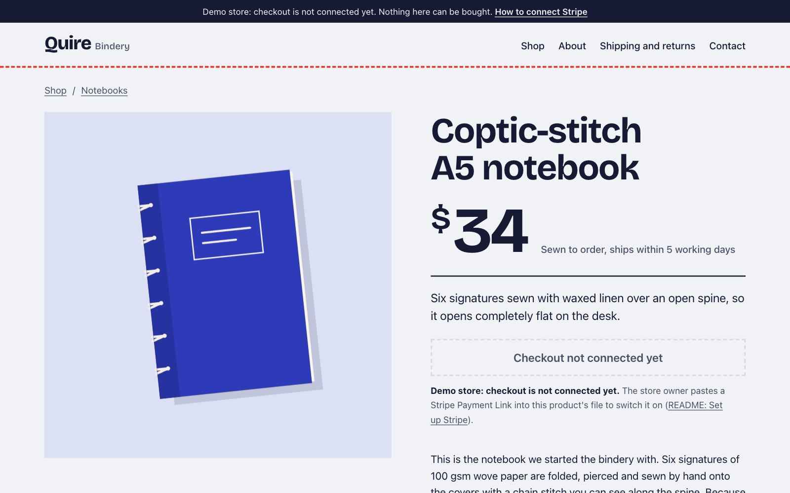

# Astro AI Shop

Add a product as a file. Paste a Stripe Payment Link. Ship.

A free Astro ecommerce theme with no backend: every product is a Markdown file, the Buy button is a link to a Stripe Payment Link, and every product page has an "Ask about this product" box that answers pre-sale questions from that page only. Static HTML, no cart, no client framework, no server routes, MIT.

[](https://fengyiqicoder.github.io/astro-ai-shop/)

**Live demo:** https://fengyiqicoder.github.io/astro-ai-shop/ · open any product and ask a question in the box under the FAQ.

[](LICENSE)
[](https://astro.build)
[](#pages)

[](https://app.netlify.com/start/deploy?repository=https://github.com/fengyiqicoder/astro-ai-shop)
[](https://vercel.com/new/clone?repository-url=https%3A%2F%2Fgithub.com%2Ffengyiqicoder%2Fastro-ai-shop&env=PUBLIC_ONETAG_KEY,PUBLIC_STRIPE_MODE&envDescription=Free%20AI%20key%20from%20onetagai.com%2C%20and%20test%20or%20live%20for%20Stripe&envLink=https%3A%2F%2Fonetagai.com%2F%3Fref%3Dastro-ai-shop&project-name=my-shop&repository-name=my-shop)
[](https://deploy.workers.cloudflare.com/?url=https://github.com/fengyiqicoder/astro-ai-shop)

| | |
|---|---|
| **Zero backend** | Static pages on any host. Stripe is the checkout, your repo is the catalogue. Nothing to run, patch or pay for. |
| **Stripe Payment Links** | One link per product, chosen at build time for test or live. The Buy button is a plain `<a href>`, no JavaScript. |
| **Ask about this product** | Visitors ask "will it fit my pen?" and get an answer written only from that product's page and your shipping policy. |
| **AGENTS.md included** | An AI coding tool can add products, set your key and paste your Stripe links by following [AGENTS.md](AGENTS.md). |

## Try the checkout

The demo store runs on Stripe test links. Click Buy on any product and pay with card `4242 4242 4242 4242`, any future expiry date and any CVC. No money moves, and you land back on the store's thank-you page. The sold-out kit has no link on purpose. In your own copy, replace the links with yours (see [Set up Stripe](#set-up-stripe)).

## Quick start

```bash
npm create astro@latest my-shop -- --template fengyiqicoder/astro-ai-shop
cd my-shop && npm install
npm run dev
```

Needs Node 22.23.4 or newer. The store opens at http://localhost:4321 with seven sample products from a made-up bindery. The Ask box answers on localhost straight away, on a shared demo key.

Copy `.env.example` to `.env` when you are ready to set your own key and Stripe mode.

## Add a product

Create one file per product in `src/content/products/`. The file name is the URL and the reference Stripe receives: `src/content/products/canvas-tote.md` becomes `/products/canvas-tote/`.

```md
---
title: Canvas tote bag
price: 24
currency: USD
image: /products/canvas-tote.svg
imageAlt: Natural canvas tote with a blue handle
summary: A heavy cotton tote with an inside pocket, big enough for an A4 notebook and a laptop.
category: desk
paymentLink: https://buy.stripe.com/REPLACE_ME
paymentLinkTest: https://buy.stripe.com/test_REPLACE_ME
badge: New
soldOut: false
featured: true
order: 8
askPlaceholder: Will a 14 inch laptop fit?
specs:
  - { label: Size, value: "38 x 42 cm, 10 cm gusset" }
  - { label: Material, value: "12 oz natural cotton canvas" }
faq:
  - q: Can I wash it?
    a: Yes, cold and inside out. Hang it to dry.
  - q: Does it close?
    a: No. It is an open tote with one inside pocket.
---

The description goes here, in Markdown. The Ask box reads it, so write what a customer would ask you by email.
```

Put the image in `public/products/`. `category` must match an `id` in `src/data/store.ts`. The schema in `src/content.config.ts` checks every field at build time, so a typo fails the build instead of shipping a broken page. Each product page gets Open Graph tags and `Product`, `Offer` and `FAQPage` JSON-LD from the same frontmatter.

## Set up Stripe

Stripe Payment Links are hosted checkout pages you create in the dashboard. You need one link per product, and the settings below live on each link, not in this repo.

1. **Create the product and link.** In the Stripe dashboard (start in test mode), go to Payment Links, create a link, add the product with a fixed price. Make the price match `price` in the Markdown file: Stripe charges what the link says.
2. **Allow quantity.** Tick "Let customers adjust quantity" and set a minimum and maximum. A static page cannot pass a quantity to the link, so the quantity picker lives on Stripe's page. If you leave it off, edit `store.checkout` in `src/data/store.ts`, because the Ask box repeats it.
3. **Collect the address and set shipping.** Tick "Collect customers' addresses", choose the countries you ship to and add a fixed shipping rate. Keep `policies` in `src/data/store.ts` in step with what you set.
4. **Redirect to your success page.** Under After payment, choose "Don't show confirmation page" and redirect to your site:
   `https://YOUR-SITE/success/?product=SLUG&session_id={CHECKOUT_SESSION_ID}`
   Stripe fills in `{CHECKOUT_SESSION_ID}`; `product` lets the page name what was bought. This is a setting on each link, so repeat it for every product.
5. **Optional: cap sales.** To sell a limited batch, set a limit on completed payments. The link turns itself off at the limit and shows your inactive message, for example "Sorry, we're out of stock for now!". Then set `soldOut: true` in the Markdown.
6. **Paste the links.** Copy the test link (`https://buy.stripe.com/test_...`) into `paymentLinkTest` and, once you switch Stripe to live mode and recreate the link there, the live link into `paymentLink`.
7. **Choose the mode.** `PUBLIC_STRIPE_MODE=test` in `.env` (and in `.github/workflows/deploy.yml`) uses the test links and shows a test-card notice across the top of the store. Run one order through with `4242 4242 4242 4242`, then set `PUBLIC_STRIPE_MODE=live` and rebuild.

The theme appends `?client_reference_id=<slug>` to every link, so each payment in Stripe shows which product page it came from. Stripe allows letters, digits, `-` and `_`, up to 200 characters, which is why product file names are lowercase with dashes. You can also add `utm_source`, `utm_medium`, `utm_campaign`, `utm_content` and `utm_term` (150 characters each) to a link in the Markdown; with a redirect set, Stripe passes them on to the success page.

Until a product has a real link, its Buy button shows "Checkout not connected yet" and a note pointing here, and the top of the store says it is a demo. Nothing breaks and nothing can be bought by accident.

## Ask about this product

Every product page has a question box. When a visitor asks something, the browser sends the question to [OneTag AI](https://onetagai.com/?ref=astro-ai-shop) together with a block of text built at build time from:

- that product's title, price, availability, summary, description, specs and FAQ;
- the store's shipping, returns, tax and payment text from `src/data/store.ts`.

It does not read other products, other pages, your Stripe account or anything about the visitor. A product's text is a few thousand characters, well inside the 32,000-character limit per question. The rules (in `src/components/AskProduct.astro`) tell the model to answer only from that text, to say when the page does not cover the question, and never to invent prices, stock or delivery dates. Answers are rendered as plain text, never as HTML.

The OneTag script loads only when someone focuses the box, so it costs nothing on page load. On localhost it answers on a shared demo key. Before you deploy, get your own free key, at [onetagai.com](https://onetagai.com/?ref=astro-ai-shop) or from the terminal (the key arrives in that inbox; one key per email):

```bash
curl -X POST https://onetagai.com/api/signup -H "Content-Type: application/json" -d '{"email":"you@example.com"}'
```

Put it in `.env`:

```ini
PUBLIC_ONETAG_KEY=ot_your_key_here
```

The key is public by design, like an analytics ID: it ships in the HTML and can only spend that account's allowance of 1,000,000 free tokens, one time, no monthly reset. Without a key the deployed store works normally and the box says Ask AI is not set up.

## Limits

These come from how Stripe Payment Links work. Read them before you choose this theme.

- **No cart.** A Payment Link holds a fixed set of items chosen when you create it (up to 20 line items), and visitors cannot add to it. This theme sells one product per checkout. Customers buying two different products check out twice, and pay shipping twice.
- **No live stock count.** The only stock control is a limit on completed payments per link; at the limit the link deactivates and shows your custom message. Stock is not shown on the site unless you set `soldOut` yourself and rebuild.
- **Shipping is a fixed rate per link.** You collect the address and choose allowed countries on the link, with a preset shipping rate. There is no calculation by weight or region.
- **Tax** needs Stripe Tax (a paid Stripe product), or Managed Payments for digital goods, where Stripe is the merchant of record.
- **No order webhook.** Fulfilment normally listens for the `checkout.session.completed` webhook. With no backend you work from Stripe's dashboard and email notifications, or connect a tool like Zapier. Payment methods that settle in 2 to 14 days need watching separately.
- **The success page cannot verify a payment.** It is a static thank-you page. The Stripe receipt is the proof of purchase.
- **Link analytics** (views, payments, revenue) can lag by up to 18 hours, are not available in the test sandbox, and do not cover links with subscription prices.
- **Pay what you want** links are capped at 10,000 USD by default, with one line item and a quantity of 1.
- **Settings are per link.** Redirect, quantity, shipping and limits have to be set on every link by hand in the Stripe dashboard.

Two things work in your favour: you can put Payment Links on your own domain (for example `pay.example.com`) in the Stripe dashboard, and Adaptive Pricing, which shows prices in the buyer's local currency, is on by default.

## Pages

Home (featured products), Shop (all products, with a page per category), Product (image, price, Buy button, specs, FAQ, Ask box, JSON-LD), About, Contact, Success (where Stripe sends buyers), Shipping and returns, Terms, Privacy and 404. Also `sitemap-index.xml`, `robots.txt`, `llms.txt` (the catalogue in plain text for AI tools) and Open Graph tags on every page.

Measured with Lighthouse on the home page and a product page, mobile and desktop: 100 for performance, accessibility, best practices and SEO. Light and dark mode follow the visitor's system setting, keyboard focus is always visible, and motion is off when the visitor asks for reduced motion.

## Deploy

- **GitHub Pages:** the included workflow builds and publishes on every push to `main`. Set Pages source to *GitHub Actions* and add a repository secret `ONETAG_KEY`. The workflow sets `BASE_PATH` for project pages; delete that line for a `you.github.io` site.
- **Netlify / Vercel / Cloudflare:** the buttons above. Set `PUBLIC_ONETAG_KEY` and `PUBLIC_STRIPE_MODE` as environment variables. Build command `npm run build`, output `dist`.

## Project layout

```
src/content/products/*.md      one file per product
src/content.config.ts          the product schema
src/data/store.ts              store name, contact, categories, shipping and returns text
src/styles/global.css          the six color tokens and the type
src/components/BuyBox.astro    Buy button: live, test, not connected, sold out
src/components/AskProduct.astro  the Ask box and its rules
src/scripts/onetag.ts          loads the OneTag script on first use; error messages
src/lib/shop.ts                prices, Payment Link choice, base-path links, Ask context
public/products/               product images
.github/workflows/deploy.yml   GitHub Pages
AGENTS.md                      instructions for AI coding tools
```

## Commands

| Command | What it does |
|---|---|
| `npm run dev` | Local store at http://localhost:4321 |
| `npm run build` | Static site in `dist/` |
| `npm run preview` | Serve `dist/` locally |
| `npm run check` | Type and frontmatter check |
| `BASE_PATH=/my-shop npm run build` | Build for a sub-path, such as a GitHub project page |

## See also

- [Astro AI Landing Page](https://github.com/fengyiqicoder/astro-ai-landing): a landing page template with a fit check and an ask-the-page box.
- [Astro AI Docs](https://github.com/fengyiqicoder/astro-ai-docs): a docs template with an Ask AI dialog that answers from your pages.

## License

MIT. Sample products, copy and illustrations are made up for the demo and free to reuse. Made by [OneTag AI](https://onetagai.com/?ref=astro-ai-shop).
